# Gantry animation steps

The steps of the Clayton Clipper's move in `src/MapView/gantryAnimation.js`, with the gantry, concrete guideway supports and finished spans
after each one. The pictures are from the Horizontal view, on the gantry's move from span 103 to span 104. Steps 1, 2 and 19, where Support C lies across a double girder span, also
have a picture from the move from span 44 to span 45.

In the step pictures, A, B and C mark the gantry's three wide supports. Each letter stays with its piece of the drawing
as it moves. The front support isn't lettered: it is always the front one.

The gantry on span 103 before it moves, with the names of its supports and the trolley crane (each support's
name as the steps use it, then its name in the code comments, its `data-anchor`, and the id of its beam in `map.svg`). The front and rear hydraulic
lifting jacks at the ends of the trusses aren't drawn on the map, so they are only labelled:

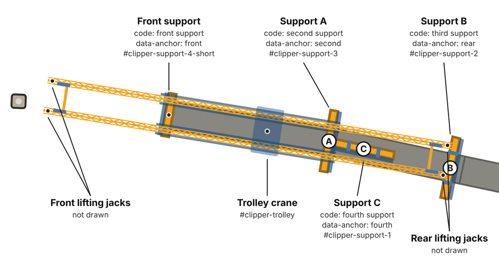

| Step          | Movement                                                                                                                                                                                                                                                                                                                                                                                                                                                                           | Stops when                                                                                                                                                        | After                                                                                                                                                 |
| ------------- | ---------------------------------------------------------------------------------------------------------------------------------------------------------------------------------------------------------------------------------------------------------------------------------------------------------------------------------------------------------------------------------------------------------------------------------------------------------------------------------- | ----------------------------------------------------------------------------------------------------------------------------------------------------------------- | ----------------------------------------------------------------------------------------------------------------------------------------------------- |
| Initial state | The span fill animation has just finished, and the blue hangers are still on. The fill stands for over 30 hours of work, from the "hanging" observation to the "cables down" observation. The segments aren't really hung in order from 1 to 12: there is a fixed pattern, simplified here for the animation.                                                                                                                                                                      |                                                                                                                                                                   | 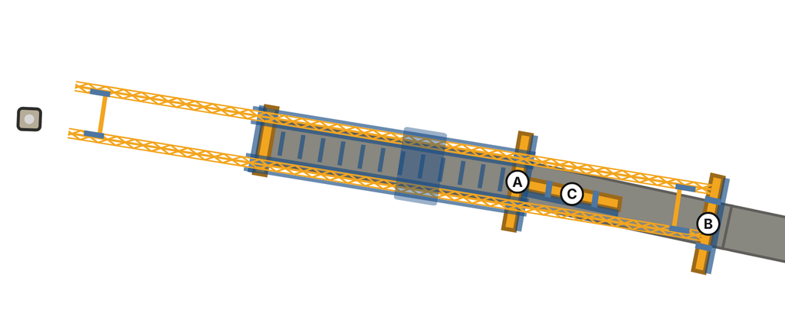                                                                                                                   |
| 1             | The trolley slides from where it is; there, the blue hangers on the finished span come down.                                                                                                                                                                                                                                                                                                                                                                                       | It is over the centre of Support C.                                                                                                                               | 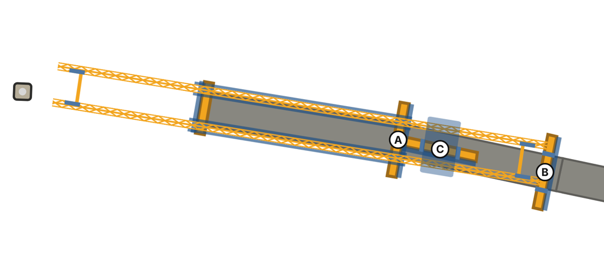 On a double girder span (span 44 to span 45): 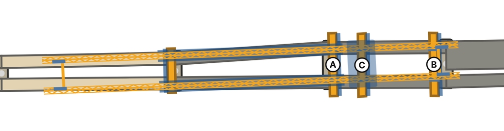   |
| 2             | The trolley lifts Support C, and they move forward together: the first part of its trip. On a double girder span Support C is drawn turned across the span, so when it is picked up there it first turns a quarter turn clockwise.                                                                                                                                                                                                                                                 | It has gone halfway along the trusses towards Support A's place on the next span (`FOURTH_TURNS_AT`).                                                             | 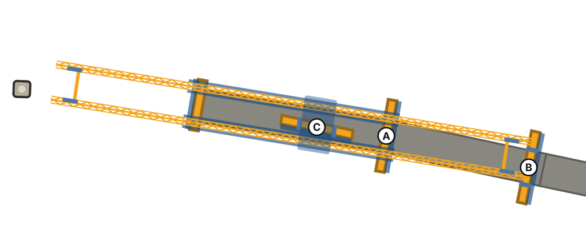 On a double girder span (span 44 to span 45): 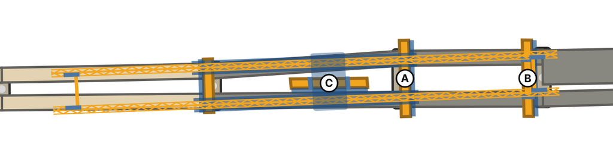   |
| 3             | Support C turns so it is perpendicular to the guideway.                                                                                                                                                                                                                                                                                                                                                                                                                            | It is perpendicular to the guideway (at Support A's angle on the next span).                                                                                      |                                                                                                                           |
| 4             | The trolley backs up with Support C and sets it down in front of Support A, where it stays for the rest of the move. As it goes, Support C turns the last little bit to the angle it has on the next span (little or nothing on straight track). The trolley then lowers Support C.                                                                                                                                                                                                | It is on Support B's place on the next span, at the angle Support B has there.                                                                                    |                                                                                                                           |
| 5             | The trolley slides back. The trolley has to be sitting over one of the three wide supports any time the trusses move.                                                                                                                                                                                                                                                                                                                                                              | It is over the centre of Support A.                                                                                                                               | 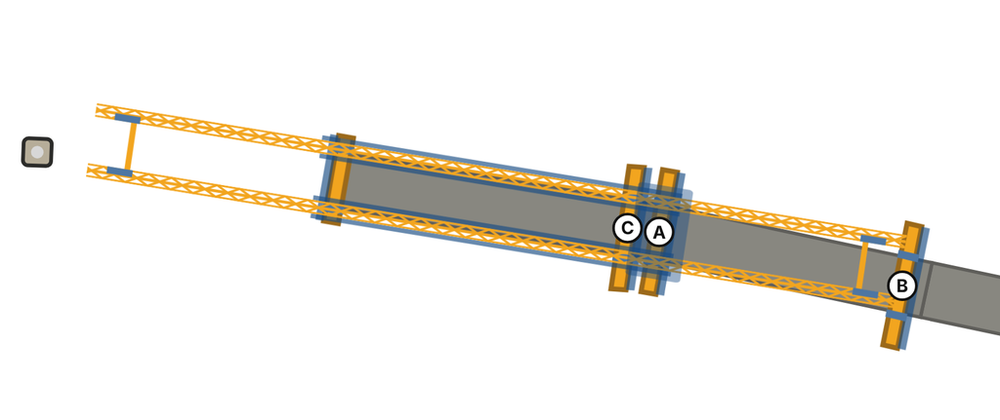                                                                                                                          |
| 6             | The trolley lifts Support A and backs up a little with it.                                                                                                                                                                                                                                                                                                                                                                                                                         | It has gone back 20 units along the trusses (`BACK_UP`).                                                                                                          | 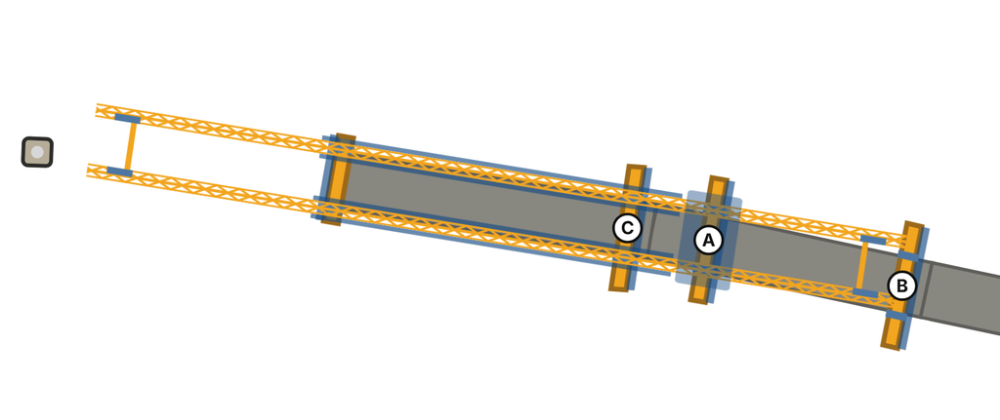                                                                                                                          |
| 7             | Support A turns sideways about its own centre, to lie lengthwise, the way Support C lay when the trolley carried it in step 2.                                                                                                                                                                                                                                                                                                                                                     | It lies lengthwise, the way Support C did in step 2 (a quarter turn across from that on a double girder span); of the ways round, the one nearest a quarter turn. | 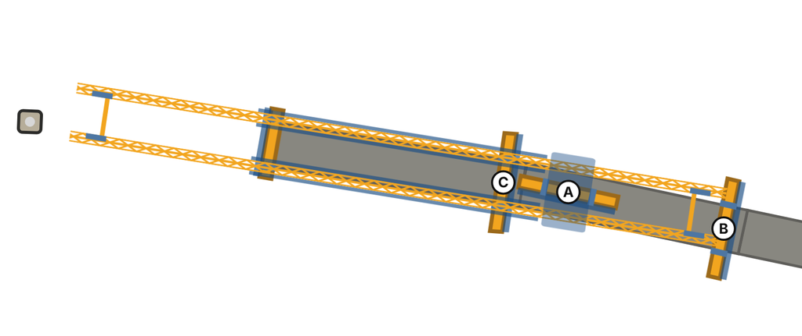                                                                                                                          |
| 8             | The trolley carries Support A forward: the first part of its trip.                                                                                                                                                                                                                                                                                                                                                                                                                 | It has gone halfway along the trusses towards Support A's place on the next span (`FOURTH_TURNS_AT`).                                                             | 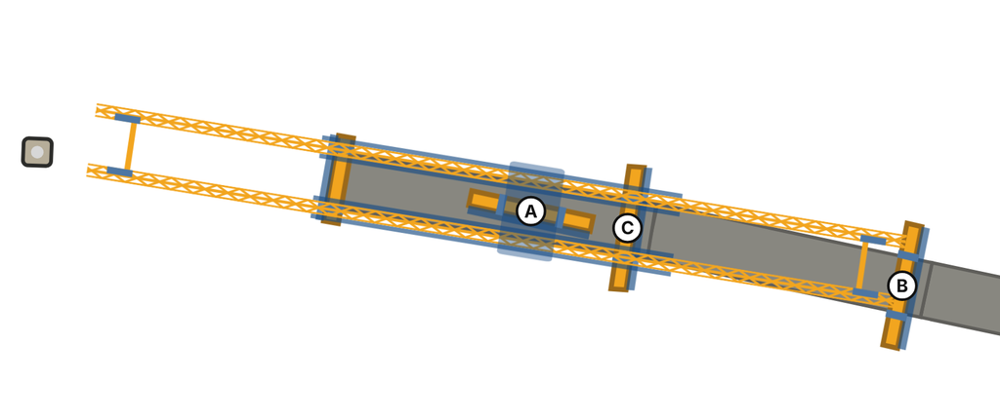                                                                                                                          |
| 9             | Support A turns so it is perpendicular to the guideway.                                                                                                                                                                                                                                                                                                                                                                                                                            | It is perpendicular to the guideway (at Support A's angle on the next span).                                                                                      | 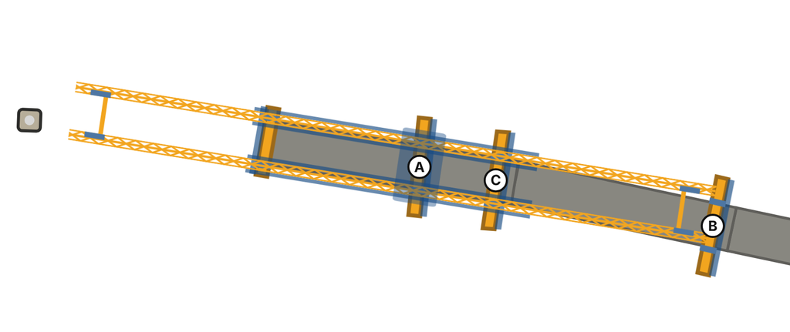                                                                                                                          |
| 10            | The rest of Support A's trip, with the trolley. The trolley then lowers Support A.                                                                                                                                                                                                                                                                                                                                                                                                 | It is just behind the front support (on Support A's place on the next span).                                                                                      | 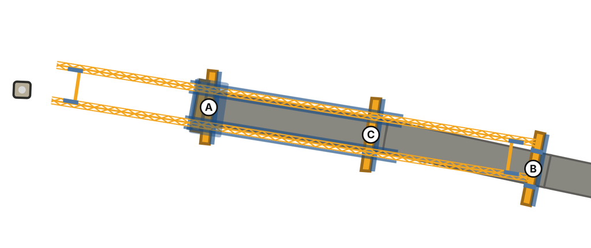                                                                                                                         |
| 11            | The trusses slide back so they can pick up the front support.                                                                                                                                                                                                                                                                                                                                                                                                                      | The front tip is over the centre of the front support, nudged by 8 units along the trusses (`PICKUP`).                                                            | 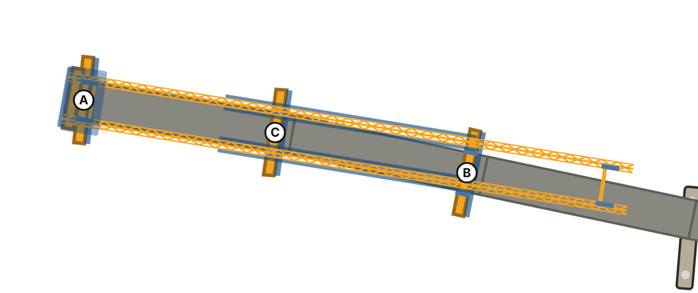                                                                                                                         |
| 12            | The front lifting jacks raise the front support, and the trusses carry it forward, the first part of its trip.                                                                                                                                                                                                                                                                                                                                                                     | Their rear tips are over the centre of Support B, or the front support's whole trip (steps 12 and 13) is done, if that comes first.                               | 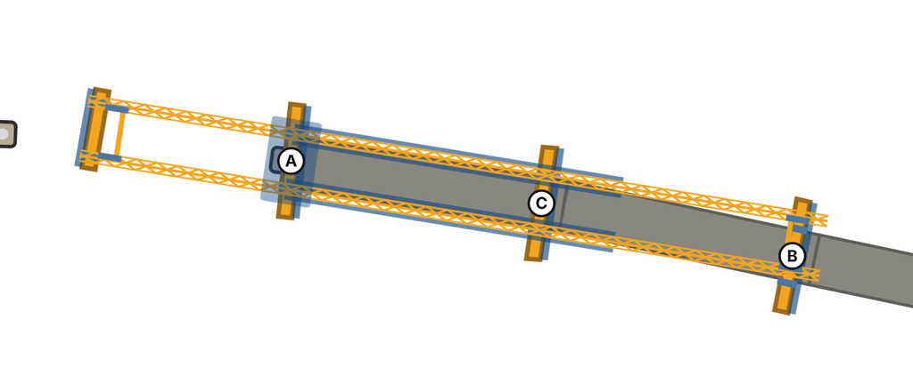                                                                                                                         |
| 13            | The rear lifting jacks raise Support B, then the trusses carry the front support the rest of its trip, with Support B riding along.                                                                                                                                                                                                                                                                                                                                                | It is the right distance from Support A for its place on the next span (step 14 swings it the rest of the way on a curve).                                        | 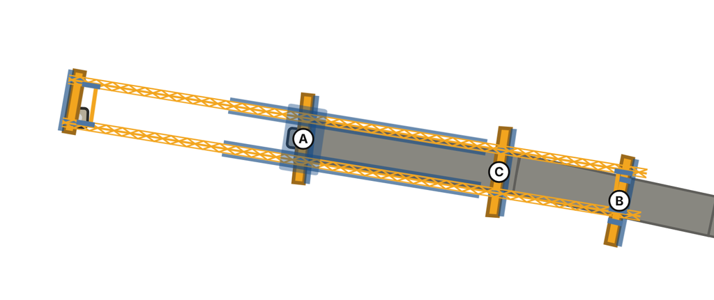                                                                                                                         |
| 14            | The trusses pivot on Support A, and their front end swings, carrying the front support. The trolley, parked over Support A, turns where it is. Support B stays raised on the rear lifting jacks as a counterweight for the front support. Skipped when it would move things less than 2 pixels on the screen (`UNSEEN`), as on straight track.                                                                                                                                     | The front support is on its place on the next span.                                                                                                               | 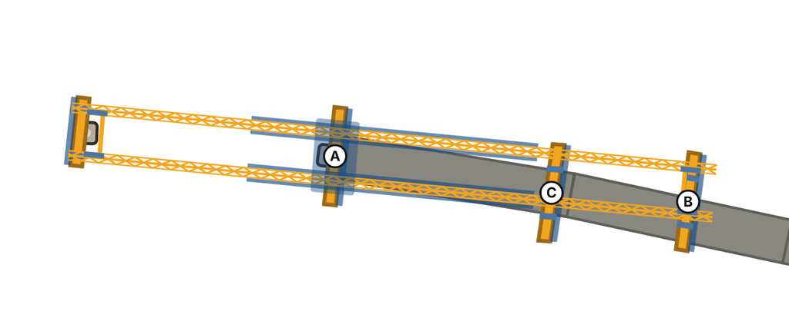                                                                                                                         |
| 15            | The front lifting jacks lower the front support onto its place. The trusses swing back the same way, and at the same time the front support turns about its own centre. At the end of the swing, with the trusses back in line, the rear lifting jacks lower Support B. Each part is skipped when it would move things less than 2 pixels on the screen (`UNSEEN`): the swing back when step 14 was skipped, the front support's turn when the ends of its beam would hardly move. | The trusses are back where they were before step 14, and the front support is at the angle it has on the next span.                                               | 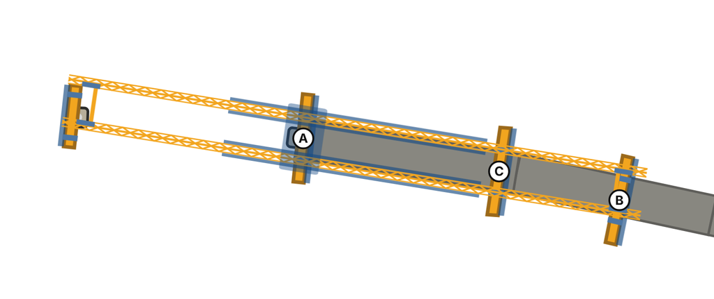                                                                                                                         |
| 16            | The trusses slide back. Support B and the front support stay where they are. If steps 14 and 15 were skipped, the rear lifting jacks lower Support B first.                                                                                                                                                                                                                                                                                                                        | Their centre is halfway between Support C and Support A.                                                                                                          | 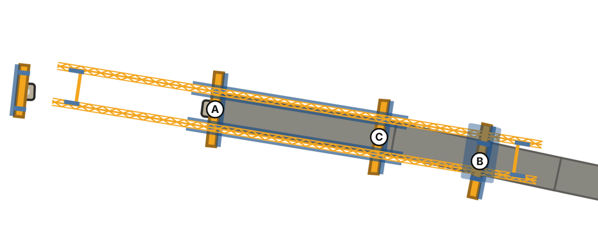                                                                                                                         |
| 17            | The trolley slides back.                                                                                                                                                                                                                                                                                                                                                                                                                                                           | It is over the centre of Support B.                                                                                                                               | 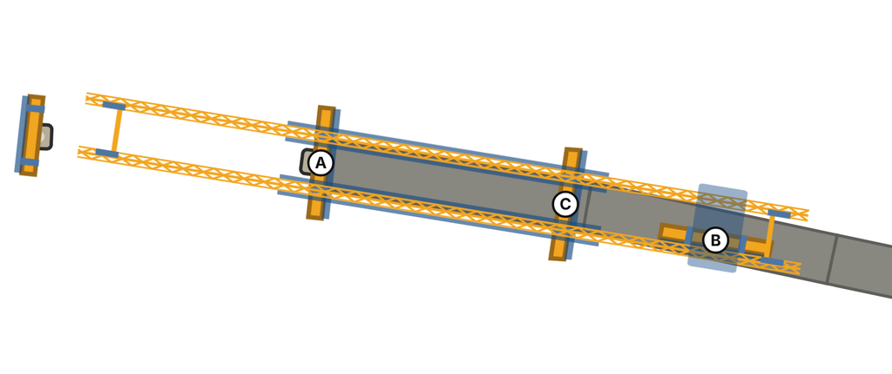                                                                                                                         |
| 18            | The trolley lifts Support B, which turns about its own centre.                                                                                                                                                                                                                                                                                                                                                                                                                     | It lies lengthwise, the way Support C lies on the next span (step 19 turns it across on a double girder span); of the ways round, the one nearest a quarter turn. | 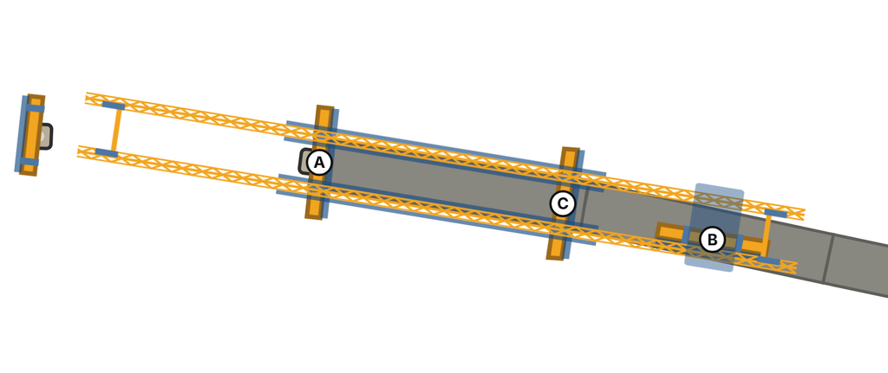                                                                                                                         |
| 19            | The trolley carries Support B forward, with a small move sideways that only the support makes. On a double girder span it is then turned across the span: a quarter turn about its centre. The trolley then lowers Support B.                                                                                                                                                                                                                                                      | Support B is on Support C's place on the next span.                                                                                                               | 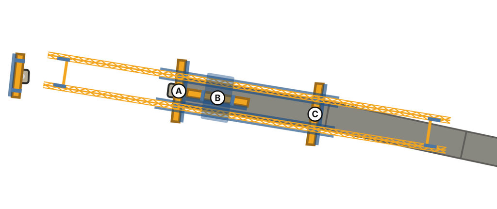 On a double girder span (span 44 to span 45): 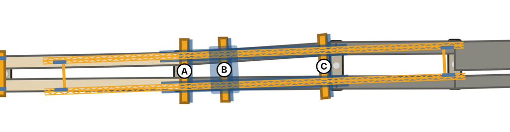 |
| 20            | The trolley slides on its own, leaving Support B where step 19 put it.                                                                                                                                                                                                                                                                                                                                                                                                             | It is over the centre of Support C.                                                                                                                               | 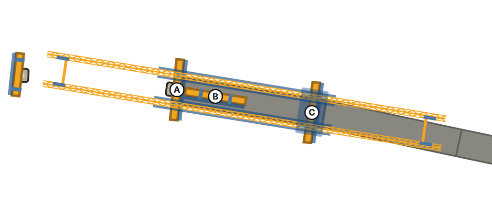                                                                                                                         |
| 21            | The trusses slide forward.                                                                                                                                                                                                                                                                                                                                                                                                                                                         | Their front ends (where the yellow truss lines stop) are 2 units past the front support's front edge (`GAP`).                                                     | 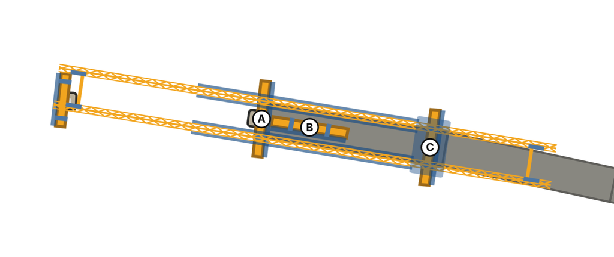                                                                                                                         |
| 22            | The trusses shift straight across and turn about Support C's centre, where the trolley is parked. Skipped when it would move things less than 2 pixels on the screen (`UNSEEN`), as on straight track.                                                                                                                                                                                                                                                                             | They are on the line they have on the next span: through the place their centre goes, at their angle there.                                                       | 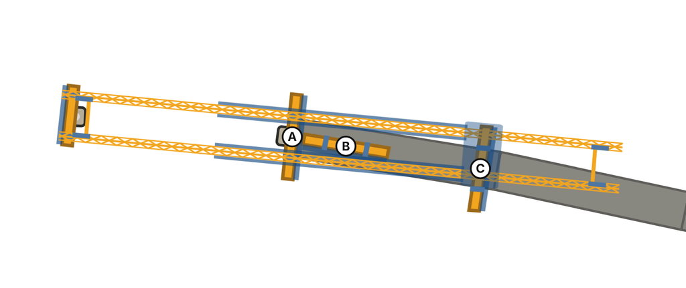                                                                                                                         |
| 23            | The trusses slide forward on their own. Skipped when it would move things less than 2 pixels on the screen (`UNSEEN`), as on straight track.                                                                                                                                                                                                                                                                                                                                       | Their centre is on its place on the next span.                                                                                                                    | 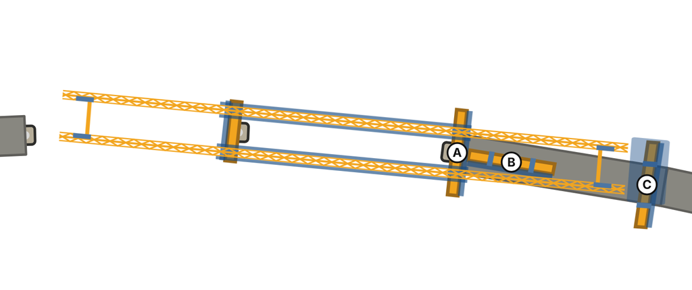                                                                                                                         |
| 24            | The trolley drives back.                                                                                                                                                                                                                                                                                                                                                                                                                                                           | It is where it started on the trusses.                                                                                                                            | 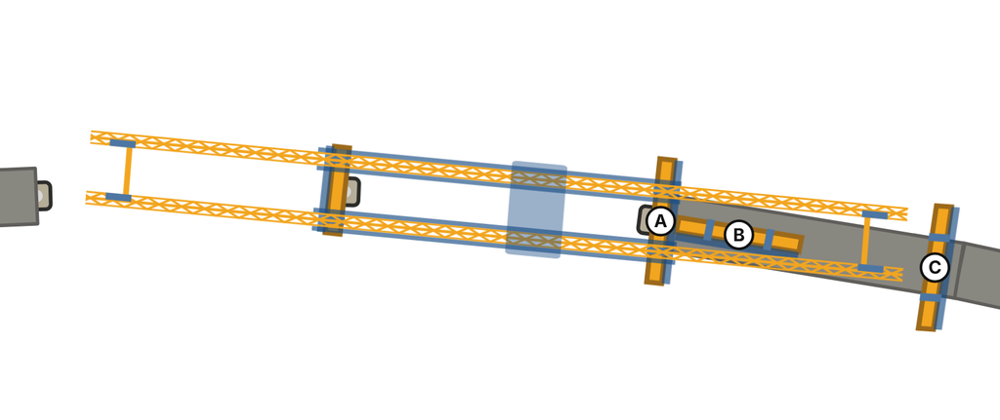                                                                                                                         |
| 25            | The drawing snaps to the gantry on the next span, span 104, not yet hung. The supports look the same, but the letters on Support B and Support C swap: each piece goes back to its own place, as in the initial state. Support A's piece is already in its place.                                                                                                                                                                                                                  |                                                                                                                                                                   |                                                                                                                          |
| Repeat        | The span fill animation runs on the next span, span 104, and the blue hangers go on: the initial state again, one span further on. The steps then repeat from step 1.                                                                                                                                                                                                                                                                                                              |                                                                                                                                                                   | 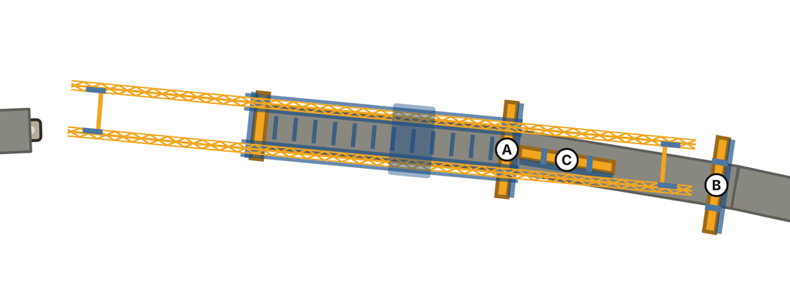                                                                                                                                 |
